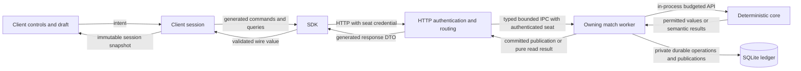

# Client, server and engine responsibility boundaries

Status: normative planning constraints; no implementation is established here.
This document governs responsibility assignments in the [client plan](game-client-plan.md),
[integration contracts](game-client-contracts.md) and [delivery plan](game-client-delivery.md).
It refines the existing [system architecture](architecture.md) and
[engine invariants](game-engine-invariants.md); it does not replace their constraints.

## 1. Ownership matrix

| Component | Owns | Must delegate or exclude |
| --- | --- | --- |
| Offline ingestion/presentation tooling (TypeScript) | Exact source extraction; allowlisted text, face and artwork metadata; stable presentation identifiers and digests | No runtime legality or game-state computation; no live source fetch in a game turn |
| Executable contracts (Rust) | Shared executable IR types, capability vocabulary and structural validation | No source parsing, hosting or UI; core and compiler may both import these contracts at runtime |
| Semantic compiler (Rust) | Complete-source lowering and semantic validation, source-to-ability identity mapping | No player interaction or network hosting; not imported by deterministic core at runtime |
| Deterministic core (Rust) | Rules state and transitions, legality, costs, priority, choices, visibility, permitted handles/projections, action beginnings, semantic query budgets, typed rules outcomes | No HTTP/authentication, database, wall clock, UI layout, text localization or strategy decisions |
| Server HTTP/supervisor | Authentication to seat, strict transport decoding, admission/rate/size limits, routing, bounded queues, worker lifecycle | No Game execution, casting predicates, target filtering, response rewriting or card strategy |
| Server match worker | Exclusive Game ownership, calls to core, scheduling, durable commit/recovery, idempotency, host clocks/statuses, publication ledger and cursors | No alternate rules interpreter; no manual alteration of core state/projections or fabricated rule outcomes |
| Generated SDK | Typed serialization, strict wire/schema validation, bounded fetch, route construction, response correlation | No legality, retries by default, persistent command journal, gameplay policy or React state |
| Client session controller | Authorization binding, compatibility, one poll lifecycle, processed cursor, latest permitted view, exact command journal, retry/reconciliation policy | No prediction of rules results or direct access to core/private host state |
| Client decision/presentation code | Human choices, draft state, formatting, grouping, selection bookkeeping, accessible controls and inspection | No executable IR interpretation, inferred visibility, recomputed eligibility or automatic strategy |
| Bot policy and runner | Policy chooses responses from permitted data; runner handles its transport/process lifecycle | No mutation of Game or host internals, hidden-state access, automatic replacement of a human owner |

The engine owns game semantics. The worker owns the live engine instance and its
durable execution. Both are Rust, but language sharing does not merge their duties.
The client stores a projection of the game, never an independently authoritative game.

## 2. Calls and data crossings

HTTP/IPC are server transport boundaries. Core calls are native in-process APIs.
The SDK never bridges directly to core; the browser never speaks worker IPC.
Neither client nor SDK imports Rust compiler/internal state layouts. Core never
imports server DTOs or SDK/client packages. Server DTOs may embed core's public
types, preserving the existing schema-authority direction.

Only the worker accesses its Game and private ledger. Any future read optimization
outside the worker requires an explicitly coherent committed public-data snapshot;
it cannot make the HTTP handler a second Game owner or a reader of private state.
Static assets and immutable catalog/presentation artifacts can be served without
invoking Game. Their authorization/integrity policy belongs to the server.

## 3. Command flow and validation responsibilities

1. UI captures an explicit choice and validates input syntax and draft shape.
2. Session checks identity/token binding, catches up known stream entries, creates
   one command envelope and journals it before submission.
3. SDK checks wire shape, exact numeric encoding, size and identifiers; sends once.
4. HTTP authenticates the capability, decodes and bounds the request, and routes
   the bound seat/command to its owning worker. Client seat labels grant no authority.
5. Worker applies idempotency/body-conflict, host phase/clock and expected-revision
   checks in the established server order. Duplicate recorded outcomes take precedence
   over stale checks. These are host admission decisions, not Magic legality.
6. Worker invokes core response validation against current state, token and viewer;
   only core decides whether the response is legal and produces any trusted receipt.
7. Worker submits through core and commits the accepted input, command status and
   associated permitted publications using the existing durable protocol. Successful
   commit precedes installation/acknowledgment. Later bounded advances and consumption
   updates use the same commit discipline; consumption is not required before the
   initial accepted acknowledgment.
8. SDK returns the immutable submission result. Session reconciles execution status
   and updates from published observations; UI renders those confirmed changes.

Validation at several boundaries is intentional: syntax/schema, authorization,
durable admission and semantic legality are different responsibilities. Submission
acceptance, rules consumption and eventual spell/ability resolution remain distinct.
Neither SDK schema success nor a host revision check proves semantic legality.

The server may map a core rejection to a documented public reason. It must not
repair a response by changing targets, payment, modes or choices, or fall back to
pass/concession. The client displays the rejection and lets the player revise intent.

## 4. Read, action and resume flows

**Semantic reads:** session → SDK → authenticated HTTP → worker → core's bound
player query. Core computes allowed beginnings, current decision constraints and
permitted source references. Worker budgets/resumes private query work, adapts the
public result into transport DTOs and returns it. Server cannot reconstruct action
availability by reading cards or mimicking engine predicates. Core supplies semantic
results; server supplies transport pagination, opaque cursor storage and request limits.
Private core continuation/state identity remains worker-owned. A public cursor is
bound to authenticated viewer, query and compatible core epoch, never a serialized Work.

**Committed resume/stream reads:** authenticated HTTP → worker → committed publication
ledger. Worker returns a coherent permitted observation, own-stream cursor and host
status/outcome. These reads do not rerun rules or regenerate handles. Core created
the semantic projection at the original boundary; the host persists and delivers it.

**Static presentation reads:** offline tooling produces a catalog-bound allowlist;
server verifies identity and serves it; client formats it. Compiler-owned semantic
ability identities map to source text during artifact production. Core supplies only
the current permitted source reference and semantic choice context; it never builds
localized prompt strings or fetches artwork. Missing mappings block clear interaction
coverage rather than inviting card-name heuristics in the UI/server.

These are three different read owners, not a rule that every GET must call core.
The current public manifest embeds compiled catalog data for existing consumers;
that does not authorize the browser to interpret its IR. New presentation components
use the allowlisted presentation contract; semantic data is passed through as opaque
protocol data except for explicitly public descriptive fields.

## 5. Rules, hints and policy examples

| Situation | Correct division |
| --- | --- |
| Cast availability and commander tax | Core determines permission and current cost; worker forwards; UI displays and requests the action |
| Selecting targets | Core supplies candidates/requirements; UI tracks selection and displayed counts; core validates joint legality at submission |
| Mana payment | UI edits exact proposed allocations and totals; core computes payable costs, available actions and valid spending/reversal semantics |
| Combat | Core determines eligibility, restrictions and lethal requirements; UI draws assignments and edits quantities; host does not implement menace/trample/other rules |
| Power/toughness or counters | Core publishes current characteristics; UI may format or group them, never recompute continuous effects |
| Hidden cards | Core decides what can be projected; host selects the authenticated seat; browser receives only its permitted view, rather than hiding a full state with CSS |
| Timeout or storage exhaustion | Host reports resource status; core alone supplies Magic win/draw outcomes |
| Automatic payment, yield or bot action | A separately scoped client/bot policy may propose a choice from permitted facts; host/core must not choose strategic defaults |
| Retry after connection loss | Client session retries exact journaled envelope; SDK sends once; host returns its durable idempotent result; core does not know command IDs |

Client input validation may check decimal syntax, duplicate selections, counts,
membership in supplied candidates and explicitly supplied numeric constraints. It
cannot derive missing rules from keywords, Oracle text or IR. Exact arithmetic for
display/drafts is acceptable; calculating a missing rule-defined cost or eligibility
is not. If controls need more information, extend the core public query/projection
and generated transport, rather than add local semantic fallback logic.

Core selects semantic context and visibility even where host joins public metadata
for display. Error detail and resource behavior must preserve the same privacy
boundary as successful responses; transport errors must not leak hidden engine facts.

## 6. Contracts and enforceable checks

Use separate version/ownership domains: executable IR (contracts/compiler), core
observations/decisions, server transport envelopes, static presentation artifacts,
and local client journals. Generate public wire types from their Rust authorities;
version the TypeScript-produced static presentation artifact in its producer schema.
Local view models and journals are not substitutes for wire schemas. The server
validates artifact integrity/shape at loading and serves it without semantic rewriting.

Implementation gates must enforce:

- Core production dependencies exclude compiler/server/network/DB/UI; existing
  development-only compiler fixtures remain permitted.
- HTTP handlers cannot execute Game; only the match worker invokes native rules APIs.
- Client components cannot import SDK runtime, network or storage adapters directly;
  only session effects do I/O. Presentation/reducer modules are pure.
- SDK runtime excludes React, policy, journal and implicit retry code.
- Client runtime bundles exclude compiler/internal engine modules, private fixtures
  and strategy policies from example consumers. Allowlisted metadata is a separate asset.
- All proposed queries reuse core semantic validation; source review checks for
  duplicated keyword/card-name/rule branches in server and client.
- Forged client hints, stale action menus and altered metadata cannot bypass core
  validation. Mock wire tests are paired with focused real-worker/core tests.
- No client/SDK changes are needed merely to support a new card using already
  supported decision shapes; new semantics/decision families require explicit
  core, host capability and client-coverage review.

Every new contract field or operation in M0 names its producing authority, transport
owner, consumer, visibility, state/budget effects and rejection semantics. Reviewers
reject contracts with unspecified ownership. Functional tests alone cannot establish
these import and semantic boundaries; combine automated dependency checks with
focused source review.
