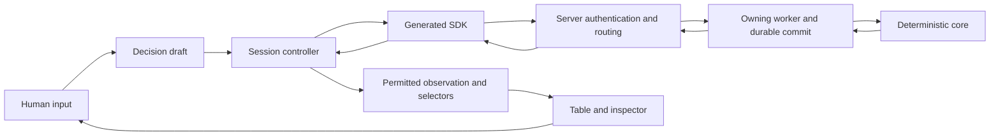

# Desktop Commander client plan

Status: planning only, 2026-11-12. No implementation or runtime acceptance is
established by this document. Josh selected a clear desktop browser client for
human play with useful inspection tools. The proposed engineering decisions below
are the implementation recommendation; later online-product decisions remain open.

Read with [integration contracts](game-client-contracts.md) and
[delivery and verification](game-client-delivery.md). The
[responsibility boundaries](game-client-boundaries.md) define the ownership matrix,
communication flows and mandatory separation checks. Existing engine authority is
the [current map](game-engine-current.md), not a historical roadmap's status line.
Source inspected for this plan: `1854e377cd2d86ef0ce5c7fa6feef7cf08df6b86`.

## 1. Product and success criteria

The first useful release lets one human finish a supported four-player Commander
game against three scripted clients. A subsequent acceptance exercise uses four
independent browser players. Initially use the already hosted foundations and
attachments profiles, with fixed approved decks. Foundations proves the complete
path; attachments is the target for the useful local alpha. Newer engine features
join the client only after explicit host admission and decision coverage review.

The player can understand the current board, priority, stack, pending choice and
result of their action. They can inspect card text and current characteristics,
make every decision reachable in the selected profile, recover communication,
and finish a match. Inspection uses the same authorized player information.

Desktop is the primary surface: target 1280×720 and larger, including browser zoom
and keyboard use. Smaller windows must retain usable decision controls through
scrolling/panels; phone-specific layout is later work. Dragging is optional.
Touch and reduced-motion support must not require a separate rules path.

Deferred: arbitrary decks, matchmaking, ratings, spectators, chat, public accounts,
offline play, browser-local search/WASM, strategic AI, game-state undo, and a 3D
table. These are separate increments with their own admission and privacy policies.

### Deferred design direction: deck-builder cohesion

Josh's direction, 2026-11-13: the game client and deck builder should feel like
closely connected parts of one product. Align the client's styling and UX with
the deck builder, including visual identity, typography, colors, spacing, card
presentation, controls, navigation and common interaction patterns. The current
client's appearance does not yet meet this expectation and is provisional.

This is a recorded future design requirement, with low current priority. Continue
gameplay and integration work before undertaking the visual/UX alignment. Plan
shared design tokens and reusable presentation primitives when that work becomes
active, while preserving the applications' existing responsibility boundaries.

## 2. Principles

1. The deterministic core exclusively evaluates rules and legality. The server
   authenticates, checks transport preconditions, invokes core validation and
   durably commits results. TypeScript renders permitted observations and captures intent.
2. Each state has one owner. Game observations, transport state and interaction
   drafts have separate lifecycles.
3. Gameplay protocols are generated from Rust. Offline presentation artifacts have
   their own producer-owned schema. UI display models may transform those types;
   they must not become competing wire definitions or interpret card IR as rules.
4. Every gameplay path works with clicks and keyboard. Visual gestures invoke the
   same intent commands. Motion explains confirmed changes and never delays input.
5. Preserve unknown outcomes. A lost response does not prove that a command failed.
6. Privacy applies to queries, errors, caches, diagnostics and history as well as
   the board. An inspector never gains another seat's hand or trusted engine state.
7. A client supports a tested profile/capability set, not every construct in the
   latest generated schema. Unknown required features produce an explicit boundary.

## 3. Technology decisions

| Concern | Recommendation | Rationale and reconsideration trigger |
| --- | --- | --- |
| Language | Strict TypeScript + HTML/CSS | Adopted project language; exact generated protocol types |
| UI | React | Existing repository experience, composable card/decision views, established browser tooling |
| Build | Vite, static output | Existing Rust API owns hosting; public SEO/server rendering is not a game-table requirement |
| Navigation | React Router declarative mode | Join, match, settings and inspection routes without inventing browser history handling |
| Rendering | DOM/CSS plus small SVG overlays | Readable text, accessibility, testable controls; canvas only after a measured need |
| Styling | CSS Modules, CSS custom-property tokens | Local style ownership and consistency with repository conventions |
| Session state | Framework-independent typed controller and explicit transitions | Single owner of polling, commands, identity and recovery |
| React binding | `useSyncExternalStore`; local reducers for drafts | Stable immutable snapshots; no effect-based copying of the whole match |
| State dependencies | Built-in TypeScript/React initially | Consider XState only if measured transition complexity warrants it; no parallel Redux/Zustand/query cache authority |
| Transport | Existing SDK, HTTP commands and long polls | Preserve proven idempotency and streams; WebSockets require a demonstrated benefit |
| Tests | Node test for pure logic; Playwright browser scenarios | Fit repository tooling; test consequential transitions and user interactions |
| Runtime schemas | Existing generated Draft7/Ajv boundary | One schema authority; browser CSP/validator generation is an explicit packaging gate |

Framework choice is an engineering judgment. React's official guidance generally
prefers frameworks and warns about ad hoc routing/data infrastructure. This client
has an existing Rust service and unusual session semantics, making the documented
Vite path a reasonable exception. React Router supplies standard routing; the
session controller is application logic required by the game's protocol.

Svelte/Vue would also render this product; no measured rendering advantage here
justifies another UI stack. Next.js becomes relevant if future product surfaces
need server-rendered content; the game table remains a distinct application.
Exact stable compatible dependency versions are resolved and locked in M0 against
the repository's pinned Node toolchain, not copied from mutable latest tags.

Official references checked during planning:
[React/Vite setup](https://react.dev/learn/build-a-react-app-from-scratch),
[React external stores](https://react.dev/reference/react/useSyncExternalStore),
[Vite backend integration](https://vite.dev/guide/backend-integration),
[React Router](https://reactrouter.com/start/declarative/installation),
[Playwright isolation](https://playwright.dev/docs/browser-contexts).

## 4. Package and dependency structure

Create `packages/game-client/` with its own `AGENTS.md`, package scripts, strict
TypeScript configuration and entry point. Follow root workspace conventions only
after inspecting the shared installation; never replace its node_modules symlink.
The SDK remains its existing isolated package until an explicit packaging change
provides a tested browser-consumption contract. Do not silently fold it into root.

```text
src/
  app/             route composition, session lifetime, error boundaries
  session/         SDK adapter, controller, stream reducer, recovery journal
  presentation/    pure selectors and display models over generated types
  decisions/       exhaustive decision adapters and draft reducers
  features/        join, table, inspector, preferences
  cards/           card face, mana, current characteristics, image fallback
  ui/              generic accessible primitives
  design/          tokens and global base styles
```

`session` and pure decision reducers have no React/DOM dependency; inject transport,
journal, scheduling and IDs for deterministic tests. `presentation` imports generated
types and pure helpers only. UI primitives know no protocol. Features compose the
lower layers through exported interfaces; only `app` owns route/session composition.
Components never call fetch. Enforce these boundaries with a small import check.

Keep one deployable client initially. Do not add shared packages for hypothetical
reuse. Reuse deck-builder design ideas and source-backed card presentation patterns;
extract shared primitives only when both consumers have demonstrated requirements.
The deck-builder retains independent release, data and authentication contracts.

## 5. State ownership and flow



The core owns authoritative rules state and transitions; the host worker owns its
live instance, execution scheduling and durable persistence. The session owns the manifest identity,
latest processed cursor, latest observation, lifecycle/outcome and outstanding
command. React owns selection, inspected card and layout preferences. A selector
may group visible objects or format quantities; it cannot implement public or hidden
rules legality. Draft checks use only supplied candidates/constraints and input syntax.
All quantity arithmetic uses exact decimal strings/BigInt, never floating point.

Connection states: disconnected, authenticating, catching-up, ready, reconnecting,
incompatible, ended. Command states are orthogonal: idle, prepared, sending,
unknown, accepted/pending, consumed, rejected, cancelled, departure-discarded.
Resource-paused and faulted are host statuses, not fabricated win/draw outcomes.

Controller start/stop is idempotent, including React Strict Mode remounts. Fence
all async completions by controller generation and authorization binding; aborting
a fetch alone does not prevent a late result from updating a new session. Release
poll/lock ownership only through the defined shutdown lifecycle.

Each draft binds match, authenticated seat and decision token. An observation
change revalidates referenced handles; a changed token invalidates the draft.
Lifecycle-only pages advance the cursor without deleting the observation.
Confirmed server state replaces the game projection; optimistic highlights and
submission indicators stay local. Never infer durable execution from animation.

## 6. Human interaction model

The table has stable player panels, own hand, battlefield groups, phase/priority,
stack, one current-decision region and a card inspector. Opponent zones reveal only
permitted contents/counts. Card identity uses object handles, not names/Oracle IDs:
two copies or a new incarnation must not inherit each other's selection state.

Selecting a card opens contextual available actions. Choosing Cast begins an
explicit core-driven decision workflow delivered by the server; it does not
auto-pay, auto-target or pass priority.
Mandatory decisions appear in the decision region; voluntary draft cancellation
is distinct from cancelling a queued command or conceding the game.

| Decision family | Human control |
| --- | --- |
| Priority | Pass and available land/cast/activation beginnings |
| Mulligan / opening bottom | Keep/mulligan, count and ordered card selection |
| Object/player/stack/entity targets | Highlight offered candidates, occurrence requirements and selected order |
| Modes / optional effects / recursion | Source text, explicit options and confirmation |
| Mana / mana color / spending / X | Exact quantity inputs, sources, cost and payment draft; nested payment context |
| Attackers / blockers | Select creature then defender/attacker; visualize assignments and offered constraints |
| Combat damage / damage allocation | Exact assignment controls and supplied requirements |
| Damage effect ordering / trigger ordering | Source descriptions and keyboard-accessible ordering |
| Discard / sacrifice / legend rule | Required count, candidate selection and previously committed choices |
| Search lands | Authorized candidate list, maximum, zero-choice behavior when permitted |
| Commander return | Object/designation, destination and explicit choice |

Generate an exhaustive request inventory from Rust for the selected source. Map
each variant to its supported profile, interaction component, fixtures and tests.
The table groups families; it is not proof of coverage. Request completion is
validated by the core through the owning worker, including joint constraints not
implied by candidate lists. Server admission checks remain a separate concern.

User-triggered transitions move focus deliberately. Remote updates announce new
decisions without stealing focus from typing or inspection; provide a keyboard
jump-to-decision action and restore focus when closing an inspector or dialog.
Use real buttons, labels, accessible names, visible focus and status announcements.
Colors have text/icon equivalents. Tooltip-only explanations are insufficient.
Reduced motion and missing images retain full playability. Auto-pass/yields and
auto-payment are later deliberate policies with interruption rules, not defaults.

## 7. Inspection, history and performance

Inspect source card text, current characteristics, attachment relationships,
visible targets and command disposition. Show player-friendly summaries by default;
technical IDs belong in an optional diagnostics view. Exported diagnostics are
bounded and scrubbed; credentials and raw private traces never enter exports.

The current stream is replacement observations/lifecycle/outcomes, not a complete
rules-event feed. Label derived history as observed changes. Complete narrative
events or replay scrubbing require a separate privacy-reviewed transport contract.
Keep a bounded window of observations; never load trusted replay bundles in-browser.

Initial engineering targets (to measure, not existing claims): normal local UI
feedback within 100 ms, no sustained polling/render loop while idle, bounded memory
after repeated reconnects, and usable input on the reviewed dense board fixture.
Record hardware/browser, object counts, payload sizes and p50/p95 input-to-render.
Use selector subscriptions, image lazy-loading and windowed inspection lists when
measurements justify them. Polling progress must continue when animations are skipped.
Do not promise representation of every engine capacity ceiling as individual DOM nodes.

## 8. Decisions still outside this local plan

Public access model, account provider, deployment host, arbitrary deck admission,
spectator visibility and strategic opponents require separate product decisions.
They do not block local human play. First implementation must resolve the explicit
M0 technical proof gates in the delivery plan; those are engineering work, not
requests for Josh to choose libraries or debug protocol details.
