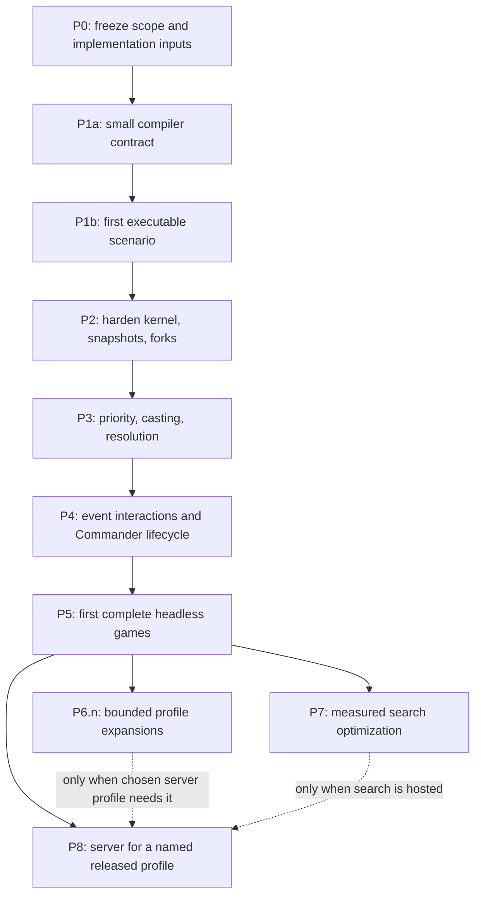

# Layer 1 implementation plan

Status: **implementation plan; language stack adopted, engine unimplemented**.
Prepared 2026-10-11. Josh selected **high-volume headless simulation and agent
search for Commander** as the primary performance workload. Commander is the
only product format in scope. Four-player headless Commander is the first
playable target; interactive Commander hosting follows the same core.

Read this document first, then the [engine specification](game-engine-spec.md)
and [runtime language decision](runtime-language-decision.md). Existing parser
contracts remain in [oracle_parser.md](oracle_parser.md) and
[data_schemas.md](data_schemas.md). This plan does not resume the interrupted
parser drafts or count their provisional gains as completed support.

## 1. Current position and completion vocabulary

The reproducible historical baseline is the
[2026-10-10 checkpoint](oracle-parser-checkpoint.md): 22,509/33,299 in-scope
cards accepted, with typechecking and 986 tests passing on the recorded source
and corpus fingerprints. That is a historical result, not a claim about a
working tree being edited now.

The initial draft also recorded an October 11 assessment of 22,656/33,590 cards
(67.45%), 986 passing tests, and an unchanged parser fingerprint on a different
corpus. Its complete assessment manifest is not attached here; treat those
numbers as historical context until its source/corpus/evidence hashes and
check results are recovered or a new baseline is captured. Never infer grammar
progress from percentages on different corpora. P0 freezes its own inputs and
records the current verified state without overwriting prior checkpoint evidence.

The existing archive is nonexecutable. Reference binding is partial;
semantic compilation and executable emission are unfinished. `build-ir`
intentionally fails. `game-engine` and `game-server` contain READMEs only.

Use separate measures throughout development:

| Measure | What it establishes |
| --- | --- |
| Parsed | Every required face/block is represented by supported syntax |
| Lowered / semantically validated | References, scopes, characteristics, functioning zones, timing, and lowering are checked against the IR contract; required capabilities are recorded |
| Admitted / executable for a configuration | The selected engine build and profile implement the required mechanics/compositions for the whole scenario or pod; distinct from compilation success |
| Scenario verified | Reviewed executions agree with the pinned rules and source data |
| Profile tested | Interaction suites and admission restrictions cover the declared playable pool |

The parser's paper-card acceptance population is not a Commander legality or
playable-card population. Engine coverage reports additionally identify the
pinned Commander legality policy and admitted commander/deck configurations.
No single percentage proves general Magic correctness. Keep source/scope hashes,
per-card results, exclusions, unsupported reasons, and interaction coverage.
The next layer can begin on a small audited subset before 98% parser coverage.

## 2. Intended outcomes

The first useful delivery is a native headless Commander pod with four simple
scripted agents, using a curated fully supported pool, with validated decisions,
visibility-correct observations, reproducible replay, and state branching.
It is not a general-purpose AI strategy or support for arbitrary decks.

The longer-term engine should support many independent games and search
branches efficiently, provide one authoritative rules implementation to every
consumer, and expand mechanics without rewriting state/identity/decision
infrastructure. Server hosting follows a proven core. Commander mechanics and
multiplayer behavior are early acceptance requirements. There is no separate
two-player-first engine or roadmap for other formats. Foundational identity,
choices, outcomes, and turn order must handle a pod shrinking through player
elimination without changing the rules profile.

An earlier engineering delivery is one complete four-seat **scenario**, from
frozen source through compilation, decision, execution, snapshot, and replay.
It is not yet a legal Commander match. This checkpoint validates the contracts
before a large compiler or state kernel accumulates around untested assumptions.

## 3. Milestones and dependencies

Basic measurement starts at P1b and structured branch benchmarks at P2; P7 is
the optimization/search gate. Every gameplay milestone extends compiler support
and admission checks alongside the engine. The early scenario uses the same
event, characteristic-query, and stabilization interfaces that later mechanics
extend. Do not create a temporary direct-mutation engine to discard at P4.

These are evidence gates, not permission to implement entire subsystems in
isolation. P1a and P1b form the first bounded work package. Later gates extend
it by vertical slices; P6 is a sequence of releases, never an unbounded
prerequisite for consumers. The native simulation/search path remains the
primary product priority even though server work has fewer hard dependencies.

### P0 — Scope and implementation inputs

**Deliver:** resolve the P0 decisions in the ledger below: initial Commander
scenario boundaries, intended playable profile, first consumer/workload,
source/rules snapshots, and benchmark reference environment.
The proposed search information policy is open decklists with private hands,
library order, and private choices; record it as session policy. Identify the
first search boundary and how permitted history enters the sampler.

The [language decision](runtime-language-decision.md) is adopted: Rust for the
compiler, core, simulation/search/native policies, and game server; TypeScript
for ingestion/parser/archive, the deck-builder, browser applications, and client
SDK. Browser-local rules use the Rust core compiled to WebAssembly. This gate
does not reopen language selection. Measure the implementation at P1b/P2 and
representative search at P7. Record provisional calibration budgets separately
from product acceptance criteria.

**Exit evidence:** a frozen scenario/workload brief, source/rules identities,
reference environment, and a checklist of remaining implementation choices.
Package scaffolding starts after these inputs are ready. No estimated completion
date is an acceptance criterion. P0 does not need to settle the later public
protocol, Rust server framework, or all numeric/IR implementation details.

### P1a — Small compiler contract and semantic examples

**Deliver:** versioned source adapter and a minimal executable IR schema;
canonical card identity/printing separation; source-characteristic validation; production
binding/lowering boundary; capability/profile manifest; deterministic writer
and strict reader. Specify characteristic-derived behavior, functioning zones,
spell-level assembly, typed outcomes, and frame shapes using the
[worked examples](game-engine-spec.md#36-worked-contract-examples-and-fixture-progression).
Choose the exact numeric backend and schema authority/generation path. Source
AST and IR versions remain separate; strict semantic decoding must preserve
unconsumed external metadata without treating it as executable content.

Start with roughly 3–5 real definitions needed for the first scenario, plus
paired rejection fixtures. Add source-backed sketches for later cross-player
choices and source movement without pretending they already execute. Include
the shape of Commander eligibility/color identity and the construction/ban
policy boundary; fuller validation arrives before P5. Pick real source objects
and digests now, not a list of card names remembered by an agent.

Implement only mechanics required by the chosen subset. Record unsupported
constructs and metadata/layout omissions explicitly. A paired unsupported card
must fail even if most of its text is executable. All faces matter.

**Exit evidence:** reviewed source→AST→binding→IR examples; compile/readback
fixtures; unknown-field/version rejection; unbound/ambiguous-reference negatives;
unsupported keyword/layout negatives;
complete source-to-IR reviews; exact hashes; transitive capability checks;
shared TypeScript/Rust contract fixtures; empty-AST basic-land
and functioning-zone cases. No raw rules-text execution, missing block, or
guessed antecedent is acceptable.
Include a draft whole-pod profile with typed exclusions and separate compilation
versus admission results. P1a emits `lowered` artifacts, not a claim of engine
executability. Unknown intrinsic behavior and unrepresented source clauses
must reject. Schema/type generation covers this subset, not every parser node.

### P1b — First executable source-to-runtime scenario

**Deliver:** the smallest four-seat scenario using P1a artifacts and one real
source-backed action path. Implement enough owned state, typed identities,
decision staging, and stack execution to activate intrinsic land mana and cast
and resolve a simple targeted spell. State may be injected by a test-only
scenario builder; use ordinary noncommander targets until return rules exist.
Scenario mode is not a legal-match admission or an arbitrary-state public API.

Introduce the production mutation path now: typed proposed/committed events,
actual result slots, a baseline characteristic query, functioning-zone checks,
and a stabilization entry point. An empty replacement/trigger registry is valid
only for this declared subset. Implement required general rules for the slice;
unsupported reachable behavior faults instead of being skipped. Do not export
this restricted scenario as a playable profile.

Use serializable frames from the start. Pause at an announcement choice, save,
restore, finish the action, and replay the same accepted inputs. Select a
versioned PRNG/shuffle contract before the first random operation; a scenario
with no randomness must consume none. Retain a minimal reproducibility bundle
with exact source, IR, build identity, initial scenario, inputs, and results.

**Exit evidence:** real source→IR→execution trace; expected event sequence and
final state; target-incarnation rejection; query purity; identical uninterrupted,
restored, and replayed results; one synthetic multi-block spell fixture; an
unsupported card/configuration rejection. Compile→admit checks identify the
actual engine build and scenario profile. Record action/query/branch timings as
initial observations, with no claim of representative Commander throughput.

**Stop and revise:** if a needed scope, result, or continuation cannot be
represented honestly, change the P1a contract before adding definitions.

### P2 — Harden state, execution control, observations, and forks

**Deliver:** extend P1b's kernel with four-player seating/live-player state,
command and other zones, physical/incarnation/commander identities,
commander-damage and cast-history tables, base/derived state separation, setup
model, complete PRNG state, serializable frames, snapshot/restore, clone-based
branching, and budget suspension.
State tables preserve departed players' required history and live-player
order. Add minimal scenario injection tooling for reviewed fixtures.

Harden event batching, pre-event views, intrinsic/active ability discovery,
outcome slots, and the stabilization contract before adding complex consumers.
Implement separate budgeted response checking, bounded submission, and automatic
advancement. Include resumable query work, invalidation on state change, and
out-of-band input boundary recording. Define observation-handle lifetimes and
the SearchContext contract; a useful hidden-world sampler is not yet required.

**Exit evidence:** identity and zone invariants; stale-handle rejection;
canonical serialization/hash tests; exact restore/fork/RNG equivalence;
branch isolation; trace-mode equivalence; private observation tests; safe
suspend/resume preserving every frame. Capture initial branch/memory benchmarks.
Test utilities must not become production legality bypasses.
Add repeated/reordered-query purity, budget-partition equivalence, incomplete
versus empty-domain queries, receipt invalidation across branches/revisions,
and resource failures without false game outcomes. Equal permitted observation
histories produce equal SearchContexts despite different unseen real states.
Verify a retained run from a fresh local artifact store with networking disabled.

### P3 — Priority, casting, activation, and resolution

**Deliver:** phase/step scheduler, priority/pass state, land plays, ordinary
casting/activation stages, costs and simple mana abilities, targets, stack,
resolution interpreter, and pause/resume decision protocol. Implement current
untap/cleanup behavior and the initially supported reversal cases. Start with
scenario states before whole-game setup is complete.
Extend the existing event/characteristic pipeline; add all SBAs and timing rules
needed by the selected P3 scenarios, including zero toughness/lethal damage
when the pool can produce them. Costs and resolving instructions cannot bypass
events. Expand toward 10–20 reviewed definitions only as these slices execute.
Command-zone casting and tax are included here. Priority/choices run around
the whole pod; all three opponents can respond. Card player references must
resolve over living opponents rather than one assumed enemy.

**Exit evidence:** pass/resolve/advance traces; correct timing rejection;
mode/target/payment staging fixtures; malformed and stale responses leave state
and RNG unchanged; source leaving before ability resolution; partial/all
target illegality; simple resolution-time decisions; agreed exact arithmetic
behavior. Compiler admission rejects unsupported costs/reversal paths.
Add four-player pass/response sequences, commander tax from explicit scenario
cast histories, casts from other zones, a countered commander still counting
as cast, per-commander
history isolation, and choices/targets involving different opponents.
Actual command-return/recast integration is a P4 requirement. Add another-player
resolution choice, spell-level multi-block targets, the sacrificed-source
ability fixture, and replay of an accepted casting attempt later reversed.

### P4 — Event interactions and complete Commander lifecycle

**Deliver:** extend hierarchical event batches and pre-event facts with supported
replacement/prevention behavior, event matching, pending trigger placement/order,
intervening conditions, actual outcome/history slots, supported SBAs, and
extensions to the reference characteristic evaluator. Begin with a small
reviewed replacement and modifier family; maintain the architecture for later
ordering/dependencies.
Commander hand/library replacement, graveyard/exile SBA return choices,
commander-damage loss checks, and multiplayer leave-game processing are required
at this gate, alongside four-player APNAP and simultaneous choices.
Explicitly classify ordinary, state, triggered-mana, delayed/reflexive, and
trigger-on-trigger families; unsupported families remain admission negatives.
Any admitted family uses its actual scheduler rather than a universal trigger
queue. The base event/decision architecture is already established at P1b/P2.

**Exit evidence:** simultaneous death/event grouping; replacement changes the
actual event and resulting trigger; APNAP/controller ordering decisions;
look-back and last-known-information fixtures; repeated SBA stabilization;
no inappropriate SBA checks between resolution instructions; temporary-effect
expiration; marked damage versus toughness; distinct zero-toughness and lethal-
damage behavior. Unsupported effect combinations fail profile admission.
Test actual commander graveyard entry before return, declined command choices,
replacement reapplication, life gain versus commander damage, noncombat versus
combat damage, and persistent designation across zones/control changes.
Test elimination during a resolving instruction/choice and during the active
player's turn, owned versus controlled objects, future turns/durations, pending
triggers, and multiple simultaneous eliminations. No player is a recycled seat.
The Unsummon/commander replacement fixture must suspend/restore at the owner's
choice and report only the actual move. Complete the command-return/recast
tests and test cross-deck interaction exclusions at whole-pod admission.

### P5 — First complete headless games

**Deliver:** Commander setup with 40 life, command-zone designation, 100-card
validated decks, multiplayer mulligans and first-turn draw; draw/untap/cleanup;
multi-defender attack/block declarations and damage; supported combat keywords;
commander-damage and ordinary losses, concession/departure, and pod completion;
a curated pool expanded as needed; four deterministic legal-choice agents;
native CLI/batch runner. Small-deck tests remain explicitly scenario mode.
Finish deck-size/singleton/color-identity/basic-land-type validation, supported
commander eligibility, unsupported multiple-commander permissions, and distinct
banned/unsupported diagnostics. Pin the first released playable profile, complete
pod configurations, policy, definition digests, typed composition constraints,
and generated-definition closure.

The pool must produce complete legal Commander decks with every card supported.
Basic-land repetition is valid; a small pool or heavily basic-land-filled decks
cannot be used to claim coverage of representative Commander strategies.

**Exit evidence:** a reviewed card-pool manifest; scripted full-game replays
covering the supported mechanics; private agents cannot observe opponent
hands/library order; rejected decks report exact missing support; no faults in
seeded four-player batch runs; no early termination after just one player loses;
commander-damage outcomes and pods shrinking through three/two/one survivors
replay correctly; all resource-truncated runs are classified separately.
Publish actual throughput, transitions/game, and memory with workload identity.
Choose the seed suite and minimum completed-run evidence before running it;
publish completion and truncation rates, rather than passing a batch where
every run was truncated. Retain each failure's replay bundle. An all-truncated
suite cannot establish complete-game support. Publish a compact gate report
with the exact profile/build/bundle identities and links to retained evidence.

**Completion claim:** “complete games for profile X and pool Y on engine Z.”
Never “the Magic engine is complete.” A random-play agent is test machinery,
not a demonstration of strategic strength.

### P6.n — Bounded Commander profile releases

P6 is an ongoing release series, not a milestone that must become universally
complete. Each P6.n names a requested deck/archetype or mechanic family, a finite
definition/configuration delta, exclusions, and an exit suite before work begins.
The previous profile remains reproducible; profiles already in running games
do not change. P8 selects P5's released profile or one specific completed P6.n.

**Deliver in bounded families:** replacement/prevention ordering and budgets;
continuous-effect layers/sublayers/timestamps/dependencies; granted abilities;
multiple/cost-dependent targets; counters and tokens; attachments; alternate/
additional costs; delayed/linked abilities; copy mechanics; history-sensitive
conditions; other layouts. Select order from real unsupported-card groups and
needed Commander decks/archetypes, not from an arbitrary keyword count.
Prioritize Commander-relevant families: multiple-commander/deck-construction
permissions, commander references and cast history, token/board-wide effects,
each-opponent actions, attack requirements and goad, politics/voting, resource
engines, extra turns, recursion, and combo/shortcut handling. Exact order and
claims follow verified source/rules families, not assumptions about keywords.

**Exit evidence per family:** source/rules review, exact AST→IR→runtime mapping,
negative near-misses, interaction matrix additions, replay/branch/observation
checks, compiler capability closure, and benchmark changes. Multiple operators
being individually implemented does not automatically admit their interaction.
Set-level coverage is a later reporting convenience, not a substitute for this
process. Partner/background and other multiple-commander configurations keep
separate commander damage/tax identities and combined pregame deck constraints.
They require explicit tests before admission. Other formats remain out of scope.

### P7 — Search API and measured optimization

**Deliver:** native decision queries, bounded enumeration adapters, in-process
rollout policies, batch jobs, cancellation, stable simulation seeding, and
profiled improvements to the largest real costs. Implement the
[SearchContext and sampled-world contract](game-engine-spec.md#81-initial-information-model-and-sampled-worlds)
for one declared pool at ordinary priority boundaries, using open decklists
and permitted observation history. Validate sampled counts/captures/history,
root-view equivalence, and independent hypothetical randomness; unsupported
reconstruction is an explicit result. Return per-player outcomes
for multiplayer search; do not assume two-player zero-sum minimax. Opponent
policies and political evaluations are strategy inputs, not rule changes.
Keep an exact correctness reference for optimizations.

**Exit evidence:** agreed search budgets met, or explicitly revised with consumer
rationale and a new versioned workload/budget record. Unexplained or unaccepted
misses leave the performance gate open; correctness evidence can still pass.
Also require per-job reproducibility across worker schedules, reduced test
cases for search mismatches, branch isolation, allocation/RSS measurements,
trace-mode equivalence, and faults/truncations excluded from completed rollout
counts. Optional copy-on-write/apply-undo must pass exact restoration properties
before replacing the baseline.
Keep omniscient microbenchmarks separate from private-information search
acceptance. Show that paired indistinguishable real states give the same sampler
inputs and seeded outputs, and that rollout policies only see their own sampled
player's view. Measure the named end-to-end search workload, including sampling,
choice generation, and disposal; throughput alone does not prove useful search.

### P8 — Server and external consumers

**Prerequisite:** one completed playable profile from P5 or a named P6.n, plus
the relevant replay/observation contracts. P7 is required only for a server
feature exposing search. Broader card coverage is not a server prerequisite.

**Deliver:** one authoritative executor per match; identity/session boundaries;
revisioned decision submission; transport idempotency; observation/event
projection; durable input journal/checkpoints; crash recovery; reconnect;
server-managed clocks and cancellation. Implement the server in Rust with direct
core calls; choose its framework and transport for the actual consumers. Provide
the generated TypeScript client contract for browser/application integration.

**Exit evidence:** four remote consumers can play an admitted Commander pod;
retries do not double-apply actions; recovery restores pending choices/RNG; per-player
private event streams are verified; slow/faulting simulations do not block
unrelated matches; resource admission and backpressure measured. Pin engine,
rules, and card versions for an entire match. Server deployments, rating,
matchmaking, spectator release, and tournament policy are separate work.

## 4. Work decomposition and implementation discipline

Each work item should state its supported wording/rule family, source/rules
edition, required IR changes, state/decision/event implications, negative
cases, interaction dependencies, and exit evidence. Implement a complete
vertical slice before widening its grammar or capability scope.

Separate state/identity, compiler/contract, event handling, characteristic
evaluation, and adapters by responsibility. Shared semantic changes need one
coherent contract review before implementation. Avoid many simultaneous edits
to shared enums and dispatch tables. Keep small reviewed fixtures in source
control; downloaded corpora, reports, generated IR, benchmarks, and build
outputs remain ignored.

Retain full run artifacts through the
[bundle and retention contract](game-engine-spec.md#71-reproducible-bundles-and-retention).
Commit compact gate summaries and small reviewed fixtures; ignored directories
are not the only copy of evidence needed to reproduce a released profile.
Each gate summary records scope, actual source/build/profile identities,
commands/check results, unresolved exclusions, and the retained bundle locator.
Never replace expected results from a failing implementation without reviewing
the underlying rules interpretation.

For each vertical slice, review the semantic example, implement lowering and
runtime behavior, exercise negative/interaction cases, and only then widen
admission. A capability registry entry requires an implementation and evidence
link; adding an enum variant alone does not advertise engine support. Changes
to general semantics invalidate affected profile evidence and require a new
build/profile assessment. Fixes to the source parser are narrowly scoped,
follow its own manual, and retain structural negative tests.

When the package is initialized, add its own `AGENTS.md` with chosen commands,
dependency rules, invariants, fixture workflow, and rules citation requirements.
Cargo commands are proposals until the Rust workspace exists; npm parser tests
remain unchanged. Do not port the parser, implement AI strategy, build UI,
select hosting infrastructure, or clean up the interrupted parser copies as an
incidental part of this plan.

## 5. Correctness and support verification

| Test family | Required examples/properties |
| --- | --- |
| Rule scenarios | Reviewed initial state + decisions + final state/trace, with exact rule references |
| Compiler negatives | Missing faces, unresolved roles, unknown op/field/version, unsupported scope/layout/keyword, mismatched source hashes |
| Intrinsic/zone semantics | Empty-AST basic lands; no double-counted reminder abilities; correct functioning zones; type-change effects once admitted |
| Semantics distinctions | Target vs choice; optional vs impossible vs replaced; sequential vs simultaneous; owner vs controller; snapshot vs reevaluated value |
| Commander rules | Tax by commander/caster; 21 combat-damage threshold per source; SBA versus replacement return; singleton/color identity/eligibility; multiplayer setup |
| Pod lifecycle | Four-player priority/APNAP; multi-defender combat; departure during turns/choices; owned/stolen objects; three/two-player survivor states |
| State properties | Zone membership, incarnation validity, attachment validity, counted resources, stack/continuation consistency |
| Determinism | Repeated run, restore midway through choices, trace modes, native architectures, shuffled collection insertion order |
| Branch/search properties | Fork+same decisions gives same result; sibling branch isolation; optimized branch path agrees with clone baseline |
| Query/resource properties | Repeated/reordered reads do not mutate semantics; incomplete query differs from no solution; budget partitions preserve results; state change invalidates work/receipts |
| Observation properties | Different unseen hands/library orders produce identical permitted observations where rules allow; no private IDs/RNG/trace leakage |
| Sampled-world properties | Identical permitted histories yield identical seeded search inputs/samples; root view matches; inconsistent captures/history reject; each rollout policy sees its own view |
| Interaction matrix | Replacement×trigger, replacement×SBA, layers×target legality, source movement×captures, costs×permissions, durations×turn changes |
| Admission/profile properties | Cross-deck forbidden combinations reject; generated definitions are closed; scenario-only manifests cannot start matches; compile success alone never admits |
| Robustness | Malformed artifacts/decisions, stale handles, large exact quantities, long event chains, budget suspension, replay version mismatch |
| Artifact recovery | Fresh-store offline bundle restore; missing/corrupt dependency rejection; dirty build identity; retained replay closure survives cleanup |
| Full-game runs | Frozen pool/policies/seeds; complete, suspended, truncated, and fault results counted separately |

Property/fuzz generation must produce legal scenario domains or test rejection
explicitly. A snapshot is evidence only after its expected meaning is reviewed;
updating hashes to make a regression pass is not validation. Differential tests
compare an optimized path to a reviewed reference path, not just two wrappers
around the same incorrect implementation.

If comparing to an external simulator later, first verify rules edition,
supported cards, and interpretation. Agreement can find bugs but does not
replace the Comprehensive Rules. No external engine is currently selected as
an oracle. During correctness review, rejecting a falsely supported card is
allowed to reduce coverage.

## 6. Performance and search plan

### Workload definitions

One **decision-boundary transition** starts from a valid decision, applies one
valid response, and runs supported automatic rules to the next decision,
safe suspension, or game completion. Track the constituent effects/events as
well: equal transition counts can conceal very different work.

Measure the core separately from agent inference, policy generation,
serialization, I/O, startup, and corpus/IR loading. Then measure those combined
for a named Commander simulation/search consumer. Benchmark fixtures are
reviewed scenarios with fixed
definitions, decisions, seeds, profile, and rule identity; synthetic scaling
cases have equivalent operation semantics but are labeled synthetic.

The ordinary full-pod workload starts with four 100-card Commander decks and
retains all players' hands/libraries, commander history, and elimination state.
Board-object dimensions below are separate from the roughly 400 physical cards
distributed across zones; token growth adds objects. Add three/two-player
survivor states without resetting match history. Include table-wide effects,
many pending triggers, multi-opponent targets, and multi-defender combat in the
dense suite. Do not extrapolate Commander speed from a two-player empty board.

| Suite | Scenario dimensions | Main metrics |
| --- | --- | --- |
| Ordinary Commander transitions | Full four-deck state, small boards/stack, command casts and simple effects | Boundaries/s/core; effects/s; p50/p95/p99 latency; allocation/transition |
| Dense Commander board | 32, 256, 1,024 battlefield objects plus other zones; varying selectors/modifiers | Candidate-query/evaluation latency; memory; cache invalidation work |
| Effect interactions | 0, 8, 64, 256 active effect/trigger definitions; replacement/SBA chains | Matcher hits, proposed/committed events, reevaluations, stabilization time |
| Branching | Ordinary/dense states; fork→query→apply→discard; 64–10,000 retained branches | Branches/s; fork latency; marginal retained bytes; disposal cost |
| Full Commander rollouts | Four legal 100-card decks, named pool/policies/setup/seeds; fixed pod count | Completed pods/s; decisions/pod; per-player results; faults; truncations; peak RSS |
| Pod shrink/choice branching | Four→three→two survivors, target subsets, attack-defender combinations | Choice-query/branch cost; correct elimination history; outcome vectors |
| Parallel jobs | 1, 2, 4, available physical-core workers | Speedup, total RSS, per-job reproducibility, load imbalance |
| Artifact/adapter | Load once; snapshots separately; batch 1/64/1,024 | Load bytes/time; boundary-copy cost; end-to-end batch throughput |

Performance changes must be evaluated against both ordinary and dense cases.
A legal-action algorithm can dominate runtime even with a fast interpreter.
Capture CPU profiles and allocation counts before selecting optimizations.

### Named end-to-end search workload

Use `commander-open-search-v1` as the proposed first consumer workload. It is a
reproducible batch evaluator for a scripted local agent, not a claim of playing
strength. P0 records the consumer and information assumptions; P1b/P2 establish
instrumentation; P5 supplies the first legal-deck source profile; P7 freezes the
exact workload manifest before optimization. Broader P6.n pools get distinct
workload versions rather than replacing the baseline invisibly.

The default shape is 32 sampled worlds from one permitted SearchContext and
up to 32 valid root-action candidates, followed by one rollout per available
world/candidate pair. Cap each trial at 256 decision-boundary transitions and
an independently declared work/memory budget. These are test-work dimensions,
not restrictions on legal game actions. The candidate generator reports its
pruning/sampling policy; fewer than 32 legal candidates do not justify inventing
actions. A candidate may require several staged responses; all validation and
choice-generation costs count. Unsupported sampling roots are reported and
excluded from supported-root claims, never filled from authoritative state.
Generate root candidates from the root player's permitted information, with
an explicit mapping into each sampled world's handles. If a hypothesis makes
one candidate infeasible, record that outcome and its treatment by the strategy;
do not silently discard inconvenient worlds or choose different root actions
using sampled opponents' secrets. Later rollout decisions use simulated views.

The workload manifest freezes exact roots, profile/pool, permitted histories,
sampler/strategy versions, numeric and RNG policy, seeds, candidate generation,
trial horizon, concurrency, trace mode, and measurement machine. Each rollout
policy consumes only its own simulated player's observation. Measure
SearchContext handling → sampling/validation → candidate generation → fork →
apply → rollout → result aggregation → disposal, including all language
crossings used by that consumer. Report component times as well as total time.

Distinguish terminal games, horizon-stopped trials, resource truncations,
unsupported roots/samples, and faults. A planned horizon produces useful
strategy input but is not a completed game; a strategy's heuristic evaluation
is not a rules-defined win/loss. Report trials evaluated and terminal games
separately. No performance denominator may hide failed or discarded sampling
work. Also measure observation-based candidates against the same strategy's
labeled omniscient benchmark only as a diagnostic comparison.

Before P7 work starts, fill in the consumer's maximum elapsed search time per
root, p95 latency, peak RSS, worker count, and minimum useful trial count in the
workload brief. These product budgets must be chosen from the consumer's needs;
they cannot be inferred from the microbenchmark numbers below. Candidate-query
or sampling bottlenecks count against the same end-to-end budget. Revisions
retain the previous results and explain the consumer tradeoff.

### Initial calibration hypotheses

The following numbers are **proposed calibration targets**, not measurements,
promises, or settled product requirements. Freeze or revise them at P0 on one
named reference machine, then keep that baseline fixed for comparison:

- Ordinary Commander core workload: at least **10,000 decision-boundary transitions/s on
  one physical core**, with tracing off and immutable definitions already loaded.
- Dense interaction workload: at least **1,000 transitions/s/core**, reported
  alongside object/effect counts and actual event work.
- Fork of the full-pod reference state with 256 battlefield objects:
  **p95 ≤ 100 μs**. Measure retained
  branches as well; creating a cheap handle is not a successful branch benchmark
  if first mutation simply pays the full cost elsewhere.
- Four-worker independent jobs: **at least 2.5×** single-worker throughput on a
  machine with four available physical cores, reporting additional memory.
- **10,000 retained ordinary Commander search branches within 2 GiB total process RSS**,
  including catalog/runtime overhead and specifying the branch scenario.

Use these to identify unacceptable representation costs in the adopted Rust
implementation. They may need revision when P5/P6 expose
representative semantics. Record revisions and rationale; do not quietly
rename a workload to meet the target. Keep remote Commander latency as a later
measured budget; simulation throughput is the initial priority.

### Measurement procedure

Record CPU model/core allocation, RAM, OS, compiler/runtime version and flags,
fixture/IR hashes, Git revision, seed/decision sets, thread count, trace mode,
build profile, startup/load inclusion, repetitions, and variance. Use optimized
Rust builds. For TypeScript client/integration measurements, separate runtime
warmup from measurement. Separate startup costs from steady-state work,
use persistent worker pools, and avoid unrelated concurrent benchmark jobs.

Require equal semantic outputs before comparing throughput. Preselect enough
repetitions for stable confidence estimates; publish raw samples alongside
summaries. Report median and tail latency rather than only the fastest run.
Do not use noisy wall-clock thresholds as universal CI failures. CI can verify
fixture correctness and large controlled regressions; reference-machine runs
provide decision evidence.

Investigate algorithmic query explosion, state copying, allocation patterns,
layer reevaluation, trace construction, and boundary serialization first.
Possible later optimizations include interning/compact IDs, selector indexes,
dependency-aware caches, chunked copy-on-write, branch journals, batched APIs,
and sparse traces. Each retains a reference behavior check. Unsafe code,
custom allocators, GPU evaluation, JITs, and concurrent mutation inside one
match require separate evidence and are not initial work items.

## 7. Risks and response plans

| Risk | Early signal | Response |
| --- | --- | --- |
| Parsed AST lacks executable scope | Guessed references or timing during P1a/P1b | Change/reject the parser shape; add structural tests; do not compensate with card-name hacks |
| Capability flags overclaim compositions | Single-card tests pass, interaction fails | Narrow admission profile and add explicit interaction gates |
| Rust development complexity | State graphs require pervasive interior mutability | Revisit owned tables/typed IDs and boundaries before adding more mechanics |
| Search copy/query cost dominates | Fork/apply or target-group benchmarks miss budgets | Profile representation/algorithms; compare clone/reference against alternatives |
| Hidden information leaks to local agents | Omniscient candidate/error/trace outputs | Enforce observation and decision types; add indistinguishability cases |
| Nondeterministic replay | Worker count/order changes per-job output | Pin RNG derivation, traversal order, exact arithmetic, canonical hashing |
| Resource limit becomes false game result | Long loop gets counted as a draw/loss | Preserve explicit suspension/truncation and rules-defined loop adjudication |
| Endless scope growth | New profile/card pool before prior gate evidence | Freeze each P6.n delta; select a named released profile for consumers |
| Early cross-language overhead | Every internal search step crosses JSON/FFI | Keep rollouts native; batch at a consumer boundary |
| Rules supplied outside Oracle AST are lost | Basic lands compile with no usable mana | Exercise intrinsic behavior and functioning zones in P1a/P1b |
| Event architecture is retrofitted | Casting/resolution mutate tables directly | Route the first executable scenario through the production event/characteristic interfaces |
| Lowering overclaims runtime support | P1a output is labeled executable with no build/profile | Separate lowered artifacts from whole-pod admission evidence |
| Retained replay cannot be reproduced | Hash exists but source/build/IR bytes are missing | Pin bundle dependencies and test fresh-store offline restoration |
| Sampling leaks hidden information | Builder copies unknown fields from the real match | Build only from SearchContext plus explicit hypotheses; reject unsupported reconstruction |

## 8. Decision ledger and first implementation brief

Decisions have explicit deadlines; do not turn every later design choice into
a prerequisite for the first scenario:

| Deadline | Decisions and evidence |
| --- | --- |
| P0, before production scaffold | Four-seat scenario scope; first consumer and proposed open-list search policy; exact source/rules snapshots; reference environment and provisional measurement goals; language stack already adopted |
| P1a, before lowering expands | Minimal source/IR authority and adapter; executable binding ownership; intrinsic/zone contracts; exact arithmetic backend; first 3–5 definitions; scenario-profile restrictions and compile/admission split |
| P1b, before scenario completion | Execution/frame/event semantics demonstrated; PRNG selection before randomness; exact build identity; source-to-runtime fixture and replay bundle |
| P2, before complex execution | Query/response/budget outcomes; snapshot/hash rules; visibility-handle lifetime; SearchContext boundary; artifact restore and retention checks |
| P5, before match-support claim | Full legal decks and pod admission; construction/ban policy; closed reachable definition pool; interaction restrictions; seeded completion evidence and released profile |
| Each P6.n | Finite scope delta, dependencies/exclusions, source/IR/runtime mappings, reviewed interaction evidence, versioned profile |
| P7, before search optimization | Supported sampling roots/history reconstruction; named workload manifest; end-to-end latency/memory/useful-trial budgets |
| P8, before remote consumers | Named released profile; external protocol authority; Rust server framework/transport and TypeScript client generation; recovery/idempotency/private-stream contract |

The first implementation brief covers **P1a + P1b only**, with P2 requirements
informing its contracts. Include the exact source records/digests, scenario
initial state, expected IR/diagnostics, accepted decision sequence, expected
events/final state, unsupported cases, commands, and exit checks. Name which
general rules the slice implements and why its scenario cannot reach excluded
mechanics. Stop at the executable-scenario evidence before enlarging the pool.

Do not start all gates at once. Record completed gates and actual artifact
identities as implementation proceeds; keep proposed and implemented APIs
distinguishable. The language decision is complete; engine scaffolding and
card-support gates require their own implementation evidence.
